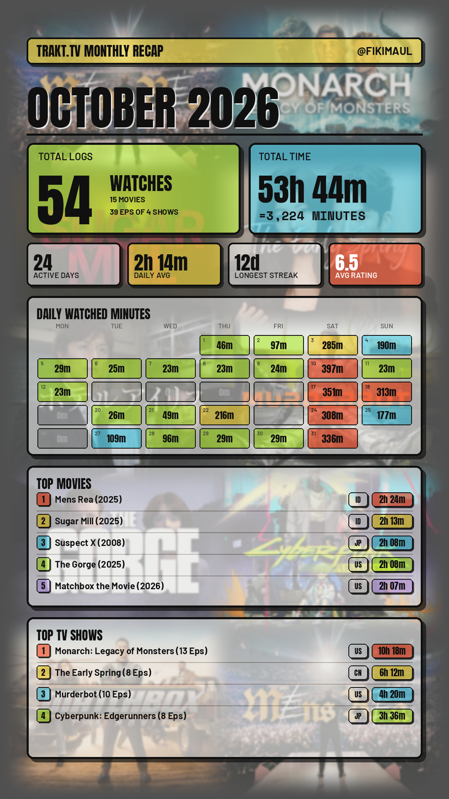
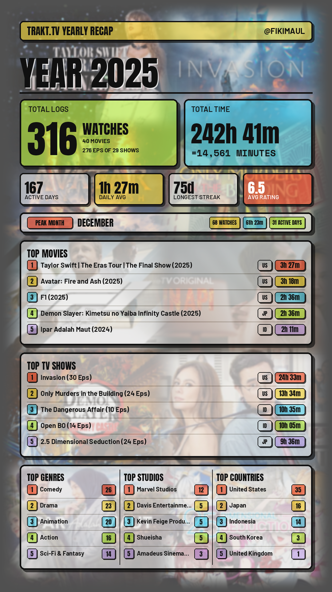

# Trakt.tv Recap Infographic Generator

A dynamic **1080x1920 PNG** Instagram Story infographic generator with a bold **Neo-Brutalism** design aesthetic, built to visualize movie and TV show watch histories exported from [Trakt.tv](https://trakt.tv).

Supports both **Monthly Recap** mode (with an interactive daily watch minutes calendar heatmap) and **Yearly Recap** mode (featuring Top Genres, Top Studios, and Top Countries analytics).

---

## Sample Reports

| Monthly Recap (`--period=2026-10`) | Yearly Recap (`--period=2025`) |
| :---: | :---: |
|  |  |

---

## Key Features

- **1-Slide Instagram Story (1080x1920)**: 9:16 aspect ratio optimized for Instagram Stories, TikTok, and messaging status updates.
- **Two Distinct Report Modes**:
  - **Monthly Mode (`--period=YYYY-MM`)**: Displays total watches, total time (hours and minutes), movie/episode/show counts, average rating, Top 5 Movies, Top 5 Shows, and a dynamic **Daily Watched Minutes Heatmap Calendar**.
  - **Yearly Mode (`--period=YYYY`)**: Features a dedicated **PEAK MONTH** banner (highlighting watch volume, total duration, and active days) and a uniform 3-column annual analytics card: **TOP GENRES**, **TOP STUDIOS**, and **TOP COUNTRIES** (grouped per title).
- **Origin Country Code Badges**: Compact ISO country code badge (`US`, `JP`, `ID`, `GB`, etc.) displayed alongside total runtime pills for Top Movies and Top TV Shows.
- **Cinematic 2x5 Collage Background**:
  - 10-cell grid featuring official **TMDB Landscape Backdrops** for the Top 5 Movies and Top 5 TV Shows.
  - **Official Transparent PNG Logos**: Centered over each cell with a soft drop shadow.
  - **Intelligent Fallbacks**: Automatically falls back to posters if backdrops are unavailable. If no logo exists on TMDB, the cell stays clean without a logo.
  - **Seamless Edge Blending**: Employs cosine alpha masks, subtle Gaussian blur (2.0px), dark cinematic tint, and a 72% blend over the signature Neo-Brutalism cream background.
  - **Alternating Pattern**: Items alternate between movies and shows (`M1, S1, M2, S2, ...`), cycling back to item #1 if fewer than 10 unique titles exist.
- **TMDB Metadata & Runtime Synchronization**:
  - Directly integrated with TMDB API v3 via multithreading (`ThreadPoolExecutor`) to fetch runtimes, genres, and production countries.
  - Results are cached locally in `tmdb_runtime_cache.json` for instant subsequent renders.
- **Dynamic Username Detection**:
  - Automatically extracts username from `data/user-profile.json` or `data/user-settings.json`.
  - Can be overridden via CLI (`--username` / `-u`) or `.env` (`TRAKT_USERNAME`).
- **Clean Output Organization**:
  - All generated graphics are neatly isolated into the `output/` directory (`output/recap-YYYY-MM.png` or `output/recap-YYYY.png`).

---

## Directory Structure

```text
trakt-recap/
├── .env.example              # Environment variable configuration template
├── .gitignore                # Git ignore rules for data, cache, and secrets
├── README.md                 # Project documentation
├── requirements.txt          # Python dependencies
├── recap.py                  # Main CLI infographic generator script
├── assets/                   # Sample report previews for documentation
│   ├── sample-monthly.png
│   └── sample-yearly.png
├── fonts/                    # Embedded open-source fonts (SIL Open Font License)
│   ├── Anton-Regular.ttf     # Header & stat font (Impact alternative)
│   ├── Barlow-Bold.ttf       # Title & label font (Arial Bold alternative)
│   ├── Barlow-SemiBold.ttf   # Subtitle & badge font (Bahnschrift alternative)
│   ├── SpaceMono-Bold.ttf    # Monospace stat font (Consolas alternative)
│   └── LICENSE.txt           # SIL Open Font License v1.1
├── data/                     # Directory for extracted Trakt.tv JSON files
│   └── .gitkeep
├── output/                   # Directory where generated PNG graphics are saved
│   └── .gitkeep
├── backdrops/                # Local cache for TMDB landscape backdrops (auto-created)
├── logos/                    # Local cache for TMDB transparent PNG logos (auto-created)
├── posters/                  # Local cache for TMDB posters (auto-created)
└── tmdb_runtime_cache.json   # Local cache for TMDB runtimes and metadata (auto-created)
```

---

## Prerequisites & Installation

### 1. Requirements
- Python 3.9 or newer.
- Operating System: Windows, Linux, or macOS (100% self-contained; all fonts are embedded with zero system font dependencies).

### 2. Clone Repository & Install Dependencies
```bash
git clone https://github.com/fikimaul/trakt-recap.git
cd trakt-recap

# Create virtual environment (optional but recommended)
python -m venv venv
venv\Scripts\activate      # Windows
# source venv/bin/activate # Linux / macOS

# Install required dependencies
pip install -r requirements.txt
```

### 3. Configure Environment Variables
Copy `.env.example` to `.env`:
```bash
cp .env.example .env        # Linux / macOS
copy .env.example .env      # Windows Command Prompt
Copy-Item .env.example .env # Windows PowerShell
```

Edit `.env` to configure your TMDB API Key:
```env
# TMDB API v3 Key (Obtain from https://www.themoviedb.org/settings/api)
TMDB_API_KEY=your_tmdb_api_key_here

# Trakt Username (Optional: automatically detected from data/user-profile.json if left empty)
TRAKT_USERNAME=your_username
```
> **Note:** A free TMDB v3 API Key can be generated by signing up at [The Movie Database (TMDB) Settings](https://www.themoviedb.org/settings/api).

---

## How to Export Trakt Data & Extract to `data/`

To generate your personalized recap infographics, you need your Trakt.tv watch history and profile data in JSON format:

### Step 1: Export Data from Trakt.tv
- **Official Trakt VIP Export (Recommended)**:
  1. Log in to your Trakt account and navigate to **Settings** > **[Data](https://trakt.tv/settings/data)**.
  2. Under the **Export Data** section, click **Export Data**.
  3. Trakt will queue your request and generate a `.zip` archive containing your complete history.
  4. Download the generated ZIP file (e.g. `trakt-export-username.zip`) once it is ready.
- **Third-Party / Open-Source Tools**:
  - You can also export your data using open-source CLI utilities like `trakt-backup` or community Trakt API export scripts.

### Step 2: Extract JSON Files to the `data/` Directory
1. Unzip the downloaded `.zip` archive.
2. Move or copy **all `.json` files** directly into the `data/` folder in the root of this project:
   ```text
   data/
   ├── watched-history-1.json
   ├── watched-history-2.json
   ├── watched-shows.json
   ├── watched-movies-1.json
   ├── ratings-movies-1.json
   ├── ratings-episodes-1.json
   ├── ratings-shows.json
   ├── user-profile.json
   ├── user-settings.json
   └── ...
   ```
> **Important:** Ensure the `.json` files are placed directly inside `data/`, not nested inside a subfolder (e.g. `data/trakt-export-username/*.json` will not be detected).

---

## Usage Guide (CLI)

Run `recap.py` using terminal or PowerShell with your desired period:

### 1. Monthly Recap Mode
Specify the period using `YYYY-MM`:
```bash
# Using --period flag
python recap.py --period=2026-10

# Using short flag -p
python recap.py -p 2026-09

# Using positional argument
python recap.py 2026-08
```

### 2. Yearly Recap Mode
Specify the year using `YYYY`:
```bash
# Yearly recap for 2026
python recap.py --period=2026

# Yearly recap for previous years
python recap.py --period=2025
python recap.py 2024
```

### 3. Dynamic Username Customization
The username displayed on the header strip is auto-detected from your export files (`data/user-profile.json` or `data/user-settings.json`). You can customize or override it on the fly:
```bash
# Override using --username or -u flag
python recap.py --period=2026-10 --username=johndoe
python recap.py --period=2026 -u moviefreak

# Or set it permanently in .env:
# TRAKT_USERNAME=johndoe
```

---

## Output Files

Rendered infographics are automatically saved into the **`output/`** directory:
- **Monthly**: `output/recap-YYYY-MM.png` (e.g., `output/recap-2026-10.png`)
- **Yearly**: `output/recap-YYYY.png` (e.g., `output/recap-2026.png`)

Temporary render files are automatically cleaned up once processing completes.

---

## License & Privacy

- Personal watch data within `data/`, secrets in `.env`, and downloaded media caches are strictly ignored by Git via `.gitignore`.
- Movie backdrops, posters, and logos are property and copyright of their respective studios and distributors via The Movie Database (TMDB).
